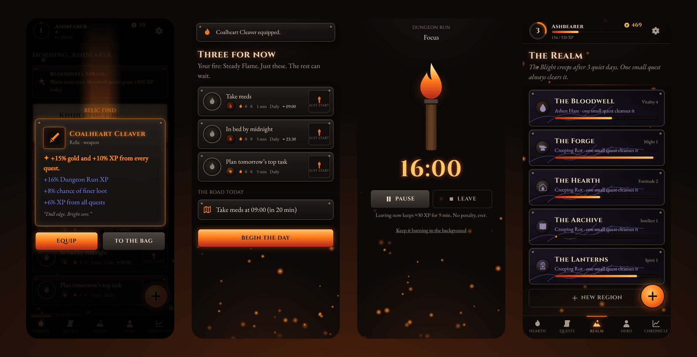
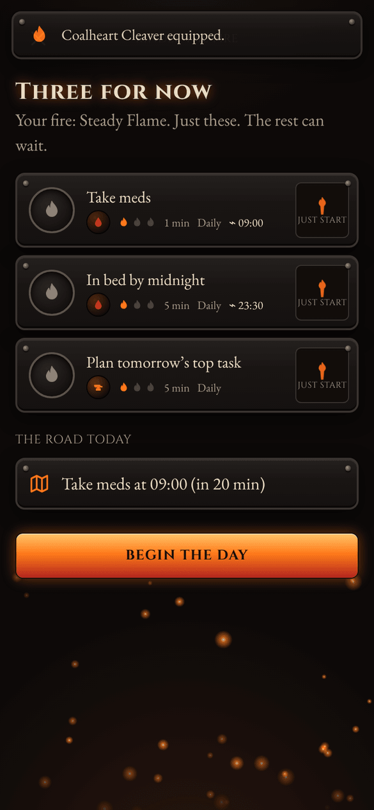
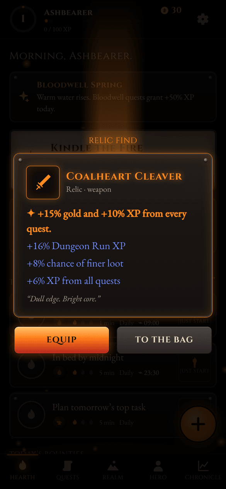
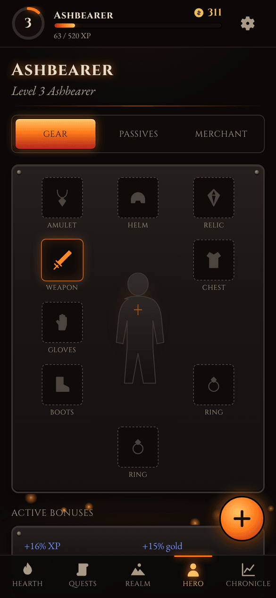
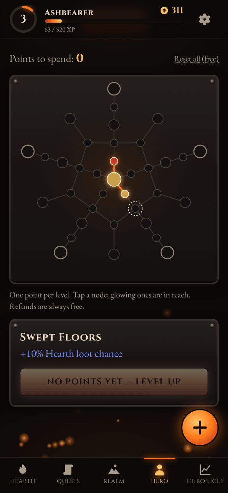
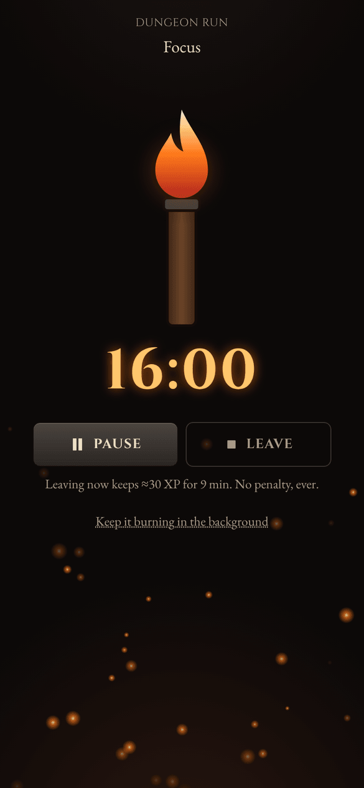
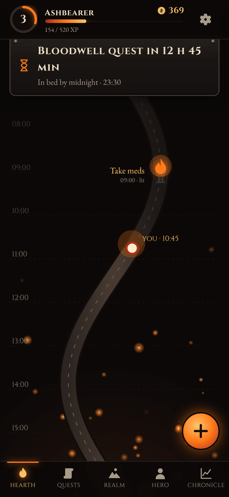
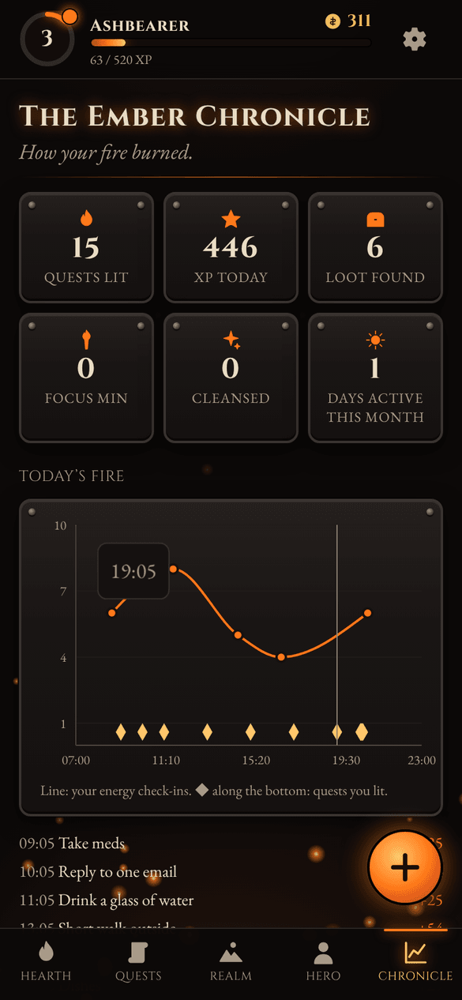
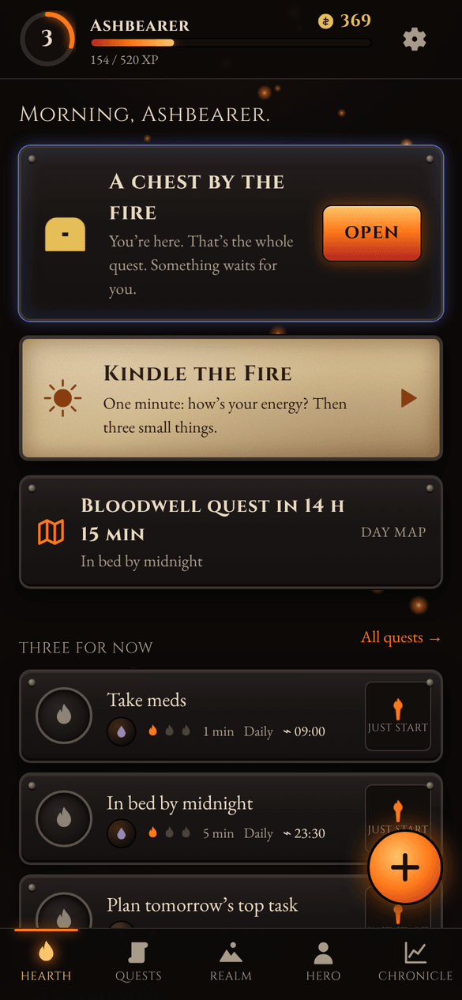
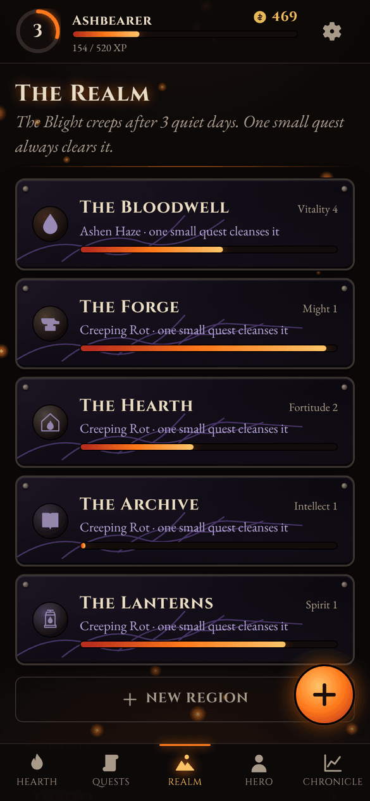

<p align="center">
  
</p>

<h1 align="center">Emberfall</h1>

<p align="center">
  A dark-fantasy life game for ADHD brains. Real tasks drop real loot.<br>
  No streaks, no red overdue lists, no guilt for disappearing for a week.
</p>

<p align="center">
  <a href="https://theratbatbose.github.io/ADHDiablo/"><b>Play in the browser</b></a> ·
  <a href="https://github.com/theratbatbose/ADHDiablo/releases/latest"><b>Download the Android app</b></a> ·
  <a href="#install-it-on-your-phone">Install guide</a>
</p>

<p align="center">
  
</p>

Most to-do apps fall apart for ADHD in the same three places. Big tasks are hard to start. Time slips by unnoticed. And the moment you miss a day, the app turns into a wall of red that makes you not want to open it again.

Emberfall borrows the loot loop from the action RPGs it's inspired by and points it at your actual life. You're the Ashbearer, carrying the last ember through a world of ash. Washing the dishes, replying to that email, taking your meds: each one feeds the fire with XP and gold, and sometimes it drops a piece of gear. Leave part of your life alone for a few days and a gentle Blight creeps over it. One small task clears it. You never lose anything you earned.

Everything stays on your phone. There's no account and no server, and it works offline.

## What's in it

### Starting is the quest



- **Kindle the Fire.** A one-minute morning check-in. Slide your energy from *Embers* (1) to *Inferno* (10) and Emberfall picks three quests that fit it. The full list is one tap away. You only see three by default, on purpose.
- **Just start.** Every quest has a torch button that opens a 5-minute Dungeon Run. Finish those five minutes and you get the quest's full XP, even if you stop there.
- **Next step only.** Bosses are big tasks split into steps. You only ever see the next step, never the whole mountain.
- **Quick capture.** The ember button in the corner takes a thought in about two seconds and drops it in an Unsorted inbox. You can sort it later, or never.

<br clear="right">

### Loot, levels and a passive tree

<p>
  
  
  
</p>

- Every completed quest has a chance to drop an item. Bigger quests drop more often, and a pity timer guarantees something at least every five quests.
- There are four rarities: **Worn**, **Enchanted**, **Rare** and **Relic**. The chest shakes, a beam of light in the rarity colour shoots up, and the item rises out. Relics have named unique effects, like *Boots of the First Step*: low-energy quests give +30% XP.
- Gear goes on a paper-doll with nine slots, and its affixes are real bonuses (XP, gold, loot chance, Dungeon Run XP). There's also a bag, a stash, and salvage-for-gold.
- Each level gives you a point for a 36-node passive tree. One branch per life area, plus nodes that unlock new colour themes. Refunds are always free.
- **The Merchant** sells rewards you set yourself, like "1 hour of gaming: 300 gold" or "Takeaway: 800 gold". Gold earned in the game pays for treats in real life.

### Time you can see

<p>
  
  
  
</p>

- **Dungeon Runs** are a focus timer drawn as a torch burning down: 5, 15, 25 or 45 minutes, or any length you pick. The timer runs on timestamps, so it stays accurate with the screen off. Pausing is fine. Leaving early still pays XP for the minutes you put in.
- **The Day Map** draws today as a road with a marker for where you are now. Scheduled quests sit along it, and finished ones turn into lit braziers. The top of the screen always says how long until the next one, e.g. *"Forge quest in 47 min"*.
- **The Ember Chronicle** is the evening view: your energy over the day, the quests you finished, XP and loot totals, and over a week or a month, when you're usually at your best ("you're usually brightest 10am–1pm").

### Falling off is allowed

<p>
  
  
</p>

- Your life areas are five regions: **the Bloodwell** (health), **the Forge** (work), **the Hearth** (home), **the Archive** (learning) and **the Lanterns** (people). Rename them or add your own.
- Leave a region quiet for three days and the Blight sets in: fog and dark veins over that region's tile. Finish any one quest there, however small, and it's fully cleansed. The Blight never touches your XP, items or level.
- Come back after two or more days away and there's a chest waiting by the fire.
- There are no streak counters anywhere. The closest thing is "days active this month".
- Every line of text in the app is written to be warm. Late tasks say *"Awaiting you"*, never *"Overdue"*.

### Small things that help

- Reminders at a quest's time, plus an optional 10-minute heads-up, and three daily nudges (morning, midday, evening) that you can switch off.
- Three daily bounties for bonus gold, and finishing all three opens a chest. About one day in six brings a world event, such as *Ember Moon*, which raises loot chance for the day.
- A quick energy check-in after big quests, so the Chronicle has something to show.
- Sounds made live in the browser, vibration on Android, and a Calm mode. It also follows your phone's reduce-motion setting.
- Banish any quest you don't need (yes, including the dishes). An Undo button appears for a few seconds.
- One-tap backup to a file, with a gentle weekly reminder.

## Web app or Android app?

Both are the same game. The difference is reminders.

| | Web app | Android app |
|---|---|---|
| Get it | [theratbatbose.github.io/ADHDiablo](https://theratbatbose.github.io/ADHDiablo/) | [Latest release](https://github.com/theratbatbose/ADHDiablo/releases/latest) (`.apk`) |
| Reminders | Only while the app is open or was used recently | Fire even when the app is closed |
| Updates | Automatic | Install the newer APK over the old one; your save is kept |
| Works offline | Yes | Yes |

Phones don't let websites schedule an alarm for later, so if you want a reminder at 9:00 while Emberfall is closed, use the Android app. Each version keeps its own save on the phone. To move from one to the other, use **Settings → Export save**, then **Import save**.

## Install it on your phone

**Android app (recommended)**

1. On your phone, open the [latest release](https://github.com/theratbatbose/ADHDiablo/releases/latest) and tap the `Emberfall-1.0.x.apk` file under **Assets**.
2. Open the download. Android will ask whether Chrome can install apps. Tap **Settings**, turn on **Allow from this source**, go back and tap **Install**.
   If Play Protect says it doesn't recognise the app, tap **Install anyway**. That happens with every app that doesn't come from the Play Store.
3. Open Emberfall, then go to **Settings → Reminders** and tap **Allow reminders**. On Android 12 or newer, also tap **Allow on-time alarms** if you see it.

**Web app**

1. Open [theratbatbose.github.io/ADHDiablo](https://theratbatbose.github.io/ADHDiablo/) in Chrome.
2. Tap **⋮**, then **Add to Home screen** (or **Install app**).

## Your save

Your save lives in the app's storage on your phone and nowhere else. Clearing site data or uninstalling the app deletes it, so export a backup now and then. The home screen reminds you about once a week. On Android, the share sheet lets you send the file straight to Drive or to yourself by email.

## How it's built

React 19, TypeScript and Vite 8, with Tailwind CSS 4, Motion and Zustand. Data is stored with Dexie (IndexedDB), using a schema version and migrations. Charts are Recharts. The installable web app uses `vite-plugin-pwa`, and the Android build uses Capacitor 8 with local notifications.

The game rules (XP, loot, the pity timer, the Blight, the return bonus, bounties, the timer maths, reminder planning) are plain functions in `src/game/`, with unit tests. Every push runs two GitHub Actions workflows: one tests the code and publishes the web app to GitHub Pages, the other builds a signed APK and attaches it to a new release.

```bash
npm install
npm run dev        # local dev server
npm test           # unit + database tests
npm run build      # type-check and production build
node scripts/icons.mjs   # regenerate app icons from public/favicon.svg
```

`CLAUDE.md` holds the design rules and architecture notes, `docs/PRD.md` is the full spec, and `IDEAS.md` is where new ideas wait until the current version has been used for a while.

## Credits

All names, items, lore, icons and art are original to Emberfall. Sounds are synthesised in code. The fonts are Cinzel by Natanael Gama and EB Garamond by Georg Duffner and Octavio Pardo, both under the SIL Open Font License.
